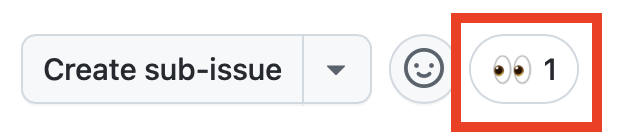

| [← 前のレッスン: カスタム指示][previous-lesson] |
|:--|

技術的負債に悩まされていない組織は、ほとんどありません。未解決のセキュリティ問題、更新が必要なレガシーコード、実装する時間がなくバックログに残った機能リクエストなどがあります。GitHub Copilot の cloud agent は、コードの更新や機能の追加などのタスクを自律的に実行できます。作業が終わると、人間の開発者がレビューできるドラフトのプルリクエスト (PR) を作成します。面倒な作業を任せて開発を加速し、開発者がより大きな課題に集中できるようにします。

この演習では、Copilot cloud agent を使って次のことを行います。

- コード生成環境をカスタマイズします。
- 操作を安全に行う方法を確認します。
- 範囲を明確に定めた issue の重要性を確認します。
- issue を Copilot に割り当てます。

## シナリオ

Tailspin Toys は技術的負債の解消を目指しています。最初のサイトを開発した委託先がドキュメントを残しておらず、アプリケーションにはドキュメントがほとんどありません。まず、エクスポートされたすべての関数に TSDoc のドキュメントコメントを追加します。

また、デザインチームはゲームを見つけやすくしたいと考えています。各ゲームの詳細ページに、同じカテゴリに属する他のタイトルを「関連ゲーム」として表示し、閲覧を続けられるようにします。現時点では、受け入れテストで UX を試せる程度の実装を求めています。優先度の高い issue がほかにあるため、この機能は現在ブロックされています。

どちらも優先順位が下がりやすいタスクです。Copilot cloud agent に割り当てると、非同期に作業を進めている間、開発者は別のタスクに集中できます。その後、戻って作業をレビューし、期待どおりか確認できます。

## GitHub Copilot cloud agent の概要

[GitHub Copilot cloud agent](https://docs.github.com/copilot/concepts/agents/cloud-agent/about-cloud-agent#overview-of-copilot-cloud-agent-formerly-copilot-coding-agent) は、人間の開発者と同様にバックグラウンドで作業できます。たとえば、[GitHub issue を Copilot に割り当てる][assign-issue]方法があります。割り当てると Copilot は進捗を追跡するドラフト PR を作成し、環境をセットアップしてタスクに取りかかります。作業中も完了後もセッションを確認できます。提案された解決策のレビュー準備ができると、プルリクエストで通知されます。

## 適切な範囲の指示が重要

GitHub Copilot に魔法はありません。考える作業を省略できるわけではありません。単純に見える操作でも、詳しく調べると複雑さが分かります。[Copilot cloud agent に依頼するタスクの範囲][cloud-agent-best-practices]を慎重に決めてください。AI ペアプログラマーとして扱い、段階を踏んで学び、試し、調整します。生成 AI を導入しても、ソフトウェア開発の基本は変わりません。

## このリポジトリのカスタム指示

前の演習では、カスタム指示と Copilot への影響を確認しました。すでにカスタム指示の演習を完了している場合は、`.github/copilot-instructions.md` が機能することを確認済みです。まだの場合は、cloud agent に作業を割り当てる前に、このリポジトリに含まれる指示ファイルを読み取り専用で確認して、後で影響を判断できるようにします。

リポジトリの GitHub Web UI、または起動済みの Codespace で次のファイルを開きます。

- `.github/copilot-instructions.md`: **Code standards** セクション、特に TypeScript の慣例と TSDoc のドキュメントコメントに関する要件を確認します。
- `.github/instructions/unit-tests.instructions.md`: `applyTo` フロントマターが `**/*.test.ts` ファイルに指示を適用していることを確認します。

次のセクションで **Code lacks documentation** issue を cloud agent に割り当てると、指示ファイルに基づく TSDoc コメント、TypeScript の慣例、コメントヘッダーが PR に反映されます。後続の演習でも、PR のレビュー時に確認します。

## Copilot cloud agent の開発環境を設定する

コードを作成するときは、開発環境やセットアップスクリプトが必要です。Copilot にタスクを割り当てる場合も同様で、ソフトウェアエンジニアのように環境を準備します。

Cloud agent は作業環境に [GitHub Actions][github-actions] を使います。作業前に実行する特別なセットアップワークフローを `.github/workflows/copilot-setup-steps.yml` に設定すると、必要な開発ツールや依存関係を利用できるように環境をカスタマイズできます。演習の円滑な進行と学習機会のため、このワークフローはあらかじめ設定されています。単一の Astro アプリ用に Node.js、プロジェクトの依存関係、エンドツーエンドテスト用のブラウザーバイナリ、マイグレーションとシードを適用した SQLite データベースを用意します。

```yaml
name: "Copilot Setup Steps"

# Allows you to test the setup steps from your repository's "Actions" tab
on: workflow_dispatch

env:
  ASTRO_TELEMETRY_DISABLED: "1"

jobs:
  copilot-setup-steps:
    runs-on: ubuntu-latest
    # Set the permissions to the lowest permissions possible needed for *your steps*. Copilot will be given its own token for its operations.
    permissions:
      # If you want to clone the repository as part of your setup steps, for example to install dependencies, you'll need the `contents: read` permission. If you don't clone the repository in your setup steps, Copilot will do this for you automatically after the steps complete.
      contents: read
    steps:
      - name: Checkout code
        uses: actions/checkout@v5

      # Frontend / app setup - Node.js (the whole app is now Astro + Drizzle/libSQL)
      - name: Set up Node.js
        uses: actions/setup-node@v6
        with:
          node-version: "lts/*"
          cache: "npm"
          cache-dependency-path: "./package-lock.json"

      - name: Install JavaScript dependencies
        run: npm ci

      - name: Install Playwright browsers
        run: npx playwright install --with-deps chromium

      # Migrate + seed the local SQLite database so builds and tests have data.
      - name: Set up the database
        run: npm run db:setup
```

ほかの GitHub ワークフローと同様ですが、重要な点がいくつかあります。

- `copilot-setup-steps` というジョブが 1 つあります。このジョブは、Copilot が PR の作業を始める前に GitHub Actions で実行されます。
- `workflow_dispatch` トリガーを使うと、リポジトリの **Actions** タブからワークフローを手動実行できます。Copilot に実行させる前に、正常に動くかテストできます。

## ドキュメントを追加する

ドキュメントの重要性は広く認識されていますが、多くのプロジェクトで情報が古かったり不足していたりします。この技術的負債を放置すると、生産性が低下し、コードベースの保守や新しいメンバーの受け入れが難しくなります。Copilot はドキュメントの作成に役立つため、cloud agent に割り当てるのに適した issue です。バックグラウンドでドキュメントを作成してもらい、後の演習で結果をレビューします。

1. 新しいブラウザータブで github.com のリポジトリを開きます。
2. **Issues** タブを選択します。
3. **New issue** を選択して、新しい issue のダイアログを開きます。
4. **Blank issue** を選択して、新しい issue を作成します。
5. **Title** に `Code lacks documentation` と入力します。
6. **Description** に次の内容を入力します。

    ```plaintext
    Our organization has a requirement that functions and methods include TSDoc doc comments where helpful. Unfortunately, recent updates haven't followed this standard. We need to update the existing code to ensure doc comments are included where they clarify behavior.
    ```

7. **Create** を選択して issue を作成します。
8. 右側の **Assign to Copilot** を選択して、割り当てダイアログを開きます。

  

9. **Assign** を選択します。
10. **Pull Requests** タブを選択します。
11. 新しく生成された PR を開きます。タイトルは `[WIP]: Code lacks documentation` のような名前になります。PR が一覧に表示されない場合は、少し待ってからブラウザーを更新します。
12. 数分後に、Copilot が To Do リストを作成したことを確認します。

> [!NOTE]
> Copilot が PR に To Do リストを表示するまで、数分かかる場合があります。前述のワークフローを実行して環境を作り、プロジェクトを分析し、問題に取り組む方法を判断しています。

13. リストと、これから実行するタスクを確認します。
14. PR のタイムラインを下にスクロールし、Copilot が issue の作業を始めたことを示す更新を確認します。
15. **View session** ボタンを選択します。

  

> [!CAUTION]
> 更新された表示を確認するために、ウィンドウを更新する必要がある場合があります。

16. ライブセッションをスクロールし、Copilot が問題に取り組む様子を確認します。コードを調べて状態を把握し、計画を検討して決定し、コードを作成するまでの作業を確認できます。

この作業には数分かかる場合があります。Copilot cloud agent の主な目的は、非同期にタスクを実行し、開発者が別の作業に集中できるようにすることです。別のタスクを cloud agent に割り当て、その間にアプリケーションの機能を実装することで、この特徴を活用します。

## ゲーム詳細ページに関連ゲームを追加する

GitHub Copilot cloud agent の利点の 1 つは、作業を分担できることです。デザインチーム向けの関連ゲームの追加に時間がかからないとしても、その時間を別の作業に使えます。Copilot cloud agent に割り当てましょう。

1. github.com のリポジトリに戻ります。
2. **Issues** タブを選択します。
3. **New issue** を選択して、新しい issue のダイアログを開きます。
4. **Blank issue** を選択します。
5. **Title** に `Show related games on the game details page` と入力します。
6. **Description** に次の内容を入力します。

    ```markdown
    We want to help people discover more games by showing related games on each game's details page. The design team wants to explore the UX and do some acceptance testing. Our requirements are:

   - Add a data-access helper in `src/lib/` that returns other games in the same category as a given game, excluding that game
   - Show a "Related games" section on the game details page that uses the helper
   - Handle the case where a game has no related games
   - There should be unit tests created for the new helper
   - Before creating the PR, ensure all tests pass
    ```

7. **Create** を選択して issue を作成します。
8. 右側の **Assign to Copilot** を選択して、割り当てダイアログを開きます。

  

9. **Assign** を選択します。

まもなく、issue の最初のコメントに 👀 が表示され、Copilot が作業を始めたことが分かります。



Copilot は 2 つ目の依頼に取り組んでいます。Copilot cloud agent はソフトウェアエンジニアと同じように動作するため、常に監視する必要はありません。作業が完了してからレビューできます。次は、カスタムエージェントの作成と使用を確認します。

## まとめと次のステップ

[GitHub Copilot cloud agent][copilot-agents] を確認しました。issue を Copilot に割り当て、非同期に作業させることができます。技術的負債の解消、新機能の作成、コードのフレームワーク間の移行などに活用できます。

次の概念を確認しました。

- コード生成環境をカスタマイズします。
- 操作を安全に行う方法を確認します。
- 範囲を明確に定めた issue の重要性を確認します。
- issue を Copilot に割り当てます。

cloud agent がバックグラウンドで作業している間に、カスタムエージェントの作成と使用に進みます。[Copilot cloud agent は MCP サーバーも利用でき][cloud-agent-mcp]、前のモジュールで確認したカスタム指示も利用できます。

## リソース

- [Copilot cloud agent について][copilot-agents]
- [GitHub issue を Copilot に割り当てる][assign-issue]
- [Copilot cloud agent セットアップワークフローのベストプラクティス][cloud-agent-best-practices]

| [次のレッスン: カスタムエージェント →][next-lesson] |
|--:|

[previous-lesson]: ../1-custom-instructions/
[next-lesson]: ../3-custom-agents/
[cloud-agent-mcp]: https://docs.github.com/copilot/how-tos/copilot-on-github/customize-copilot/customize-cloud-agent/extend-cloud-agent-with-mcp
[assign-issue]: https://docs.github.com/copilot/how-tos/use-copilot-agents/cloud-agent/start-copilot-sessions
[setup-workflow]: https://docs.github.com/copilot/how-tos/copilot-on-github/customize-copilot/customize-cloud-agent/customize-the-agent-environment
[copilot-agents]: https://docs.github.com/copilot/concepts/agents/cloud-agent/about-cloud-agent
[cloud-agent-best-practices]: https://docs.github.com/copilot/how-tos/copilot-on-github/customize-copilot/customize-cloud-agent/customize-the-agent-environment
[github-actions]: https://docs.github.com/actions
