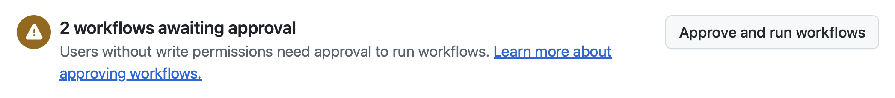

| [← 前のレッスン: エージェントの管理][previous-lesson] |
|:--|

これまでの演習では、GitHub Copilot にユーザー体験の改善と機能追加に関する複数のタスクを依頼しました。コードへのドキュメント追加、デザインチームが試せる関連ゲーム機能の構築、ハイコントラストとライトモード切り替え機能などです。コードの変更を確認し、必要なら Copilot にフィードバックして改善しましょう。

## 作業をレビューする

生成 AI を使っても、ソフトウェア設計と DevOps の基本は変わりません。生成されたコードをレビューし、通常の DevOps プロセスに沿って進めます。チームのコードレビューを有効にする前に、GitHub Copilot が作成したドキュメント、関連ゲーム機能、アクセシビリティ機能の提案を確認します。

### シナリオ

非同期に動作して監視を必要としない Copilot cloud agent には、安全のための制約があります。次の制約が適用されます。

- Copilot はリポジトリへの読み取りアクセスのみを持ち、書き込みアクセスはコード用ブランチに限定されます。
- Cloud agent は GitHub Actions 内に作業用の一時的な環境を作成します。
- GitHub Actions のワークフローを実行するには、人間の承認が必要です。
- [外部リソースへのアクセスは、MCP サーバーを含め、既定で制限されています](https://docs.github.com/copilot/how-tos/copilot-on-github/customize-copilot/customize-cloud-agent/customize-the-agent-firewall)。

## 生成されたドキュメントをレビューする

まず、GitHub Copilot cloud agent がコードにドキュメントを追加するために作成した最初のプルリクエスト (PR) を確認します。GitHub.com の標準的な PR インターフェイスを使います。

> [!NOTE]
> PR を確認するとき、GitHub Copilot がファイアウォールでブロックされたという警告が表示される場合があります。Copilot は外部 MCP サーバーへの呼び出しなど、外部リソースへのアクセスが既定で制限されているため、これは**想定どおり**です。必要であれば、[Copilot cloud agent のファイアウォールをカスタマイズまたは無効化][agent-firewall]できます。

1. github.com のリポジトリに戻ります。
2. **Pull Requests** を選択して PR の一覧を開きます。
3. **Add missing documentation** などのタイトルの PR を開きます。

> [!NOTE]
> Copilot がまだ作業中の場合、PR のタイトルに **[WIP]** が含まれています。その場合は作業が完了するまで待ちます。数分かかることがあります。その間に、学んだことを振り返ってもかまいません。

4. PR の準備ができたら **Files changed** タブを選択し、変更を確認します。

    

5. 新しく追加された TSDoc コメントなど、更新されたコードとドキュメントを確認します。変更内容は状況によって異なります。

   変更を確認するときは、レッスン 2 の冒頭で確認した指示ファイルに基づく TSDoc コメント、TypeScript の慣例、コメントヘッダーを確認します。

6. 更新内容をレビューして問題がなければ **Conversation** タブに戻り、下にスクロールします。
7. 承認待ちのワークフローを示す表示を確認します。
8. ワークフローが承認待ちの場合は、**Approve and run workflows** を選択します。

   

9. ワークフローが PR のチェックに追加されたことを確認します。問題がなければ、単一の Astro アプリのプロジェクトチェックが成功します。完了まで数分かかる場合があります。

## GitHub Copilot に変更を依頼する

Copilot との PR 作業は一方通行ではありません。チームメンバーと同様に、PR やコードへのインラインコメントで Copilot にメンションできます。Copilot はコメントを確認し、対応するための新しいセッションを開始します。結果は確定的ではないため、必ずしも特定の依頼文を使う必要はありません。たとえば、次のような変更を依頼できます。

- 各コードファイルの先頭に、目的を簡潔に説明するコメントヘッダーを追加する。
- TypeScript と Astro のファイルに TSDoc のドキュメントコメントを追加する。
- Astro アプリの構造を説明する README を作成する。

1. 上記の例、またはコードベースに必要な別のドキュメント更新を使い、**@copilot** をメンションして変更を依頼するコメントを追加します。
2. **View Session** を選択し、Copilot が作業する様子を確認します。Copilot が更新用の新しいセッションを開始します。
3. **Back to pull request** を選択すると PR に戻れます。

    

4. Copilot が変更を完了したら、PR に新しいコミットが追加されたことを確認します。
5. **Files changed** タブを選択し、変更をレビューします。

納得できるまで反復して改善できます。準備ができたら、ドラフト PR をレビュー可能な状態に変更して `main` ブランチにマージします。


## 関連ゲーム機能をレビューする

ゲーム詳細ページに関連ゲームを表示する issue に対して、Copilot が作成した PR を確認します。

1. GitHub.com のリポジトリに戻ります。
2. **Pull Requests** タブを選択します。
3. **Show related games on the game details page** などのタイトルの PR を選択します。
4. **Files changed** タブを選択し、生成されたコードをレビューします。
5. 更新を確認して問題がなければ **Conversation** タブに戻り、下にスクロールします。
6. 承認待ちのワークフローを示す表示を確認します。
7. ワークフローが承認待ちの場合は、**Approve and run workflows** を選択します。

   

8. ワークフローが PR のチェックに追加されたことを確認します。問題がなければ、単一の Astro アプリのプロジェクトチェックが成功します。完了まで数分かかる場合があります。
9. **任意:** Codespace でこのブランチに切り替え、関連ゲーム機能を手動でテストできます。Codespace に移動してターミナルを開き、次のコマンドを実行します (`<branch-name>` は Copilot が作成したブランチ名、例: **copilot/fix-8** に置き換えます)。

    ```bash
    git fetch origin
    git checkout <branch-name>
    ```

Copilot は関連ゲーム機能を実装しました。これまでと同様に、Copilot cloud agent にコメントして変更を依頼できます。たとえば、関連ゲームの表示件数を変更したり、この issue をカスタム指示の更新前に割り当てたため、コメントヘッダーと TSDoc コメントを追加したりできます。**Conversation** タブにコメントを追加すると、Copilot が内容を確認して新しいセッションを開始します。

## アクセシビリティ機能をレビューする

最後に、アクセシビリティのカスタムエージェントで実装した機能をレビューします。この PR には、演習 3 で依頼したハイコントラストモードと、演習 4 で mission control から追加を依頼したライトモードの両方が含まれます。

1. GitHub.com のリポジトリに戻ります。
2. **Pull Requests** タブを選択します。
3. **Add high contrast mode to website** などのタイトルの PR を選択します。

> [!NOTE]
> Copilot がまだ作業中の場合、PR のタイトルに **[WIP]** が含まれています。作業が完了するまで数分待ちます。

4. **Files changed** タブを選択し、生成されたコードをレビューします。
5. 実装を確認し、特に次の点を確認します。
   - モード切り替え用のユーザーインターフェイス (UI) コンポーネント
   - ユーザー設定を保持するためのローカルストレージの使用
   - ハイコントラストモードとライトモード用の CSS またはスタイルの変更
   - アクセシビリティ属性 (Accessible Rich Internet Applications (ARIA) ラベル、キーボード操作など)
   - モードの切り替えを管理する JavaScript/TypeScript コード
6. 更新を確認して問題がなければ **Conversation** タブに戻り、下にスクロールします。
7. 承認待ちのワークフローを示す表示を確認します。
8. ワークフローが承認待ちの場合は、**Approve and run workflows** を選択します。

   

9. ワークフローが PR のチェックに追加されたことを確認します。問題がなければ、単一の Astro アプリのプロジェクトチェックが成功します。完了まで数分かかる場合があります。
10. **任意:** Codespace でこのブランチに切り替えてアクセシビリティ機能を手動でテストできます。Codespace に移動してターミナルを開き、次のコマンドを実行します (`<branch-name>` は Copilot が作成したブランチ名に置き換えます)。

    ```bash
    git fetch origin
    git checkout <branch-name>
    ```

    次にアプリケーションを起動し、ブラウザーでハイコントラストとライトモードの切り替えをテストします。ページを再読み込みしても設定が保持されることを確認します。

アクセシビリティのカスタムエージェントが、アクセシビリティのベストプラクティスに沿うよう Copilot の実装をガイドしたことを確認できます。アクセシビリティ上の問題や改善点があれば、前の PR と同様にコメントで **@copilot** に更新を依頼できます。

## 任意の演習 — 委任を続ける

Cloud agent に実際のバックログ項目を任せ、その間に別の作業へ集中することができます。いくつか issue を作成して Copilot に割り当て、習慣にしてみましょう。次のようなアイデアがあります。

- ゲーム詳細ページに支援者向けの関心フォームを作成する。
- ゲーム一覧ページにページネーションを実装する。
- データアクセスヘルパーに入力検証とエラー処理を追加する。

## まとめ

Cloud agent のハーネスを完了しました。各レッスンで、次の操作を行いました。

- このリポジトリに含まれるカスタム指示ファイルを確認し、cloud agent の出力に与える影響を把握しました。
- issue を Copilot cloud agent に割り当て、環境のセットアップ、計画、非同期の実行を確認しました。
- アクセシビリティ用のカスタムエージェントを作成して使い、ハイコントラストとライトモードの切り替えを追加しました。
- Copilot エージェントページを mission control として使い、作業中のアクセシビリティセッションを監視して案内しました。
- cloud agent のプルリクエストをレビューして改善し、**@copilot** に変更を依頼し、ワークフローを承認しました。

## 振り返りと次のステップ

Cloud agent のハーネスを完了しました。引き続き確認する場合は、他のハーネスで今回の内容をさらに学べます。

- 🖥️ **[VS Code ハーネス](../../vscode/)** — IDE から Copilot Chat の agent mode と MCP 統合を確認します。
- 💻 **[CLI ハーネス](../../cli/)** — Plan と Autopilot モード、エージェントスキル、カスタム QA エージェント、Playwright MCP、Agent Merge、cloud agent に戻る任意の `/delegate` 連携を使い、ターミナルからレビュー済みの変更を 2 つリリースします。

自分のリポジトリで、次の作業を試してみましょう。

- リファクタリングやテストカバレッジの issue を cloud agent に割り当てます。
- 別の分野向けのカスタムエージェントを作成します。
- 別の技術スタック向けに `copilot-setup-steps.yml` を設定します。

## リソース

- [GitHub Copilot][github-copilot]
- [Copilot エージェントについて][copilot-agents]
- [GitHub issue を Copilot に割り当てる][assign-issue]
- [Copilot cloud agent セットアップワークフローのベストプラクティス][cloud-agent-best-practices]
- [Copilot cloud agent のファイアウォールを構成する][agent-firewall]

---

| [← 前のレッスン: エージェントの管理][previous-lesson] |
|:--|

[github-copilot]: https://github.com/features/copilot
[cloud-agent-overview]: https://docs.github.com/copilot/concepts/agents/cloud-agent/about-cloud-agent
[assign-issue]: https://docs.github.com/copilot/how-tos/use-copilot-agents/cloud-agent/start-copilot-sessions
[setup-workflow]: https://docs.github.com/copilot/how-tos/copilot-on-github/customize-copilot/customize-cloud-agent/customize-the-agent-environment
[copilot-agents]: https://docs.github.com/copilot/concepts/agents/cloud-agent/about-cloud-agent
[cloud-agent-best-practices]: https://docs.github.com/copilot/how-tos/copilot-on-github/customize-copilot/customize-cloud-agent/customize-the-agent-environment
[agent-firewall]: https://docs.github.com/copilot/how-tos/copilot-on-github/customize-copilot/customize-cloud-agent/customize-the-agent-firewall

[previous-lesson]: ../4-managing-agents/
