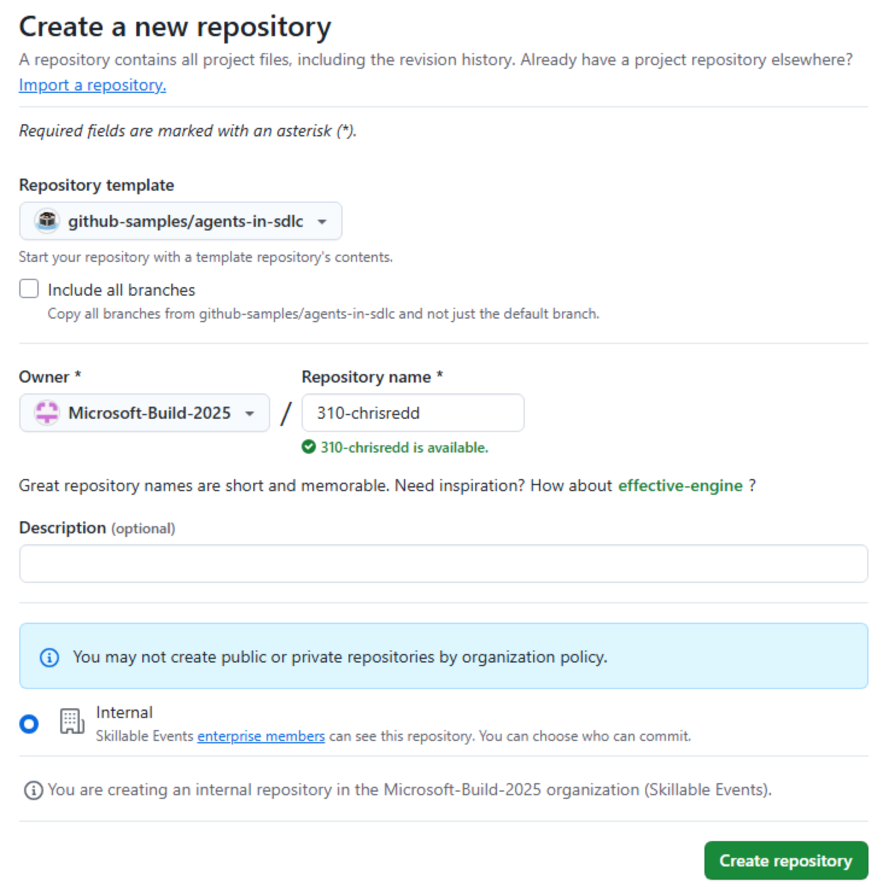

Antes de começar os exercícios do VS Code, prepare o ambiente. Você criará uma cópia própria do repositório Tailspin Toys, iniciará um [Codespace][codespaces] e confirmará que o GitHub Copilot Chat está funcionando no editor.

## Configurar o repositório do laboratório

Crie uma cópia do repositório a partir do [modelo][template-repository]. A cópia conterá todos os arquivos necessários para os exercícios.

1. Em uma nova janela do navegador, acesse o [modelo Tailspin Toys][tailspin-template].
2. Crie uma cópia selecionando o botão **Use this template** na página do repositório do laboratório. Em seguida, selecione **Create a new repository**.

   

3. Se estiver participando de um evento conduzido pelo GitHub ou pela Microsoft, siga as instruções dos mentores. Caso contrário, crie o repositório em uma organização na qual você tenha acesso ao GitHub Copilot.

   

4. Anote o caminho do repositório criado (**organization-or-user-name/repository-name**), pois você precisará dele mais adiante.

> [!NOTE]
> **Seu backlog está pronto**
>
> Ao criar o repositório a partir do modelo, um backlog de issues do GitHub será criado automaticamente. Você trabalhará com essas issues durante o workshop; não precisa criar nenhuma.

## Criar um Codespace

Em seguida, você usará um Codespace para concluir os exercícios.

[GitHub Codespaces][codespaces] é um ambiente de desenvolvimento na nuvem que permite escrever, executar e depurar código diretamente no navegador. Ele oferece um ambiente de desenvolvimento integrado (IDE) completo, com suporte a várias linguagens, extensões e ferramentas.

1. Acesse o repositório que acabou de criar.
2. Selecione o botão verde **Code**.

   

3. Selecione a guia **Codespaces** e selecione o botão **+** para criar um Codespace.

   

A criação do Codespace levará alguns minutos, embora ainda seja muito mais rápida do que instalar todos os serviços manualmente. Enquanto isso, você pode explorar outros recursos do GitHub Copilot; vamos abordá-los em seguida.

> [!CAUTION]
> Você voltará ao Codespace em outro exercício. Por enquanto, mantenha-o aberto em uma guia do navegador.

> [!NOTE]
> Este workshop foi criado para ser executado em um Codespace ou em um [contêiner de desenvolvimento][dev-containers] local. Ambos garantem que o ambiente tenha todos os pré-requisitos necessários. Se preferir trabalhar localmente, abra o repositório clonado no VS Code e selecione **Reopen in Container** quando solicitado. O VS Code criará o mesmo contêiner de desenvolvimento usado pelo Codespace.

[codespaces]: https://github.com/features/codespaces
[dev-containers]: https://code.visualstudio.com/docs/devcontainers/containers

## Usar o GitHub Copilot Chat e o modo de agente

Para usar o modo de agente do GitHub Copilot Chat, instale a extensão GitHub Copilot Chat no ambiente de desenvolvimento integrado (IDE). Ela já deve estar instalada se você estiver usando um GitHub Codespace.

> [!TIP]
> Se a extensão GitHub Copilot Chat não estiver instalada, você pode [instalá-la pelo Visual Studio Code Marketplace][copilot-chat-extension]. Outra opção é abrir a visualização Extensions no Visual Studio Code, pesquisar **GitHub Copilot Chat** e selecionar **Install**.

Depois de instalar a extensão, talvez seja necessário autenticar-se com sua conta do GitHub para habilitá-la.

1. Volte ao Codespace.
2. Se o Copilot Chat não estiver à direita do editor, selecione o ícone **Copilot Chat** na parte superior do Codespace.
3. Digite uma mensagem, como "Hello world", na janela do Copilot Chat e pressione <kbd>Enter</kbd>. Isso deve ativar o Copilot Chat.
4. Se você ainda não estiver autenticado, será solicitado que entre na sua conta do GitHub. Siga as instruções para autenticar-se.

   

5. Depois da autenticação, a janela do Copilot Chat deverá aparecer.

## Resumo

Parabéns, você criou uma cópia do repositório do laboratório e iniciou a criação do Codespace que usará quando começar a escrever código.

## Próxima etapa

Agora, vamos começar a usar o Copilot. Continue para [Exercício 1 - Instruções personalizadas][next-lesson], no qual você ensinará ao Copilot as convenções do projeto.

## Recursos

- [Visão geral do GitHub Codespaces][codespaces]
- [Criar um repositório a partir de um modelo][template-repository]
- [Introdução ao Codespaces][codespaces-quickstart]

[tailspin-template]: https://github.com/github-samples/tailspin-toys
[template-repository]: https://docs.github.com/repositories/creating-and-managing-repositories/creating-a-template-repository
[codespaces-quickstart]: https://docs.github.com/codespaces/getting-started/quickstart
[copilot-chat-extension]: https://marketplace.visualstudio.com/items?itemName=GitHub.copilot-chat
[next-lesson]: ../1-custom-instructions/
